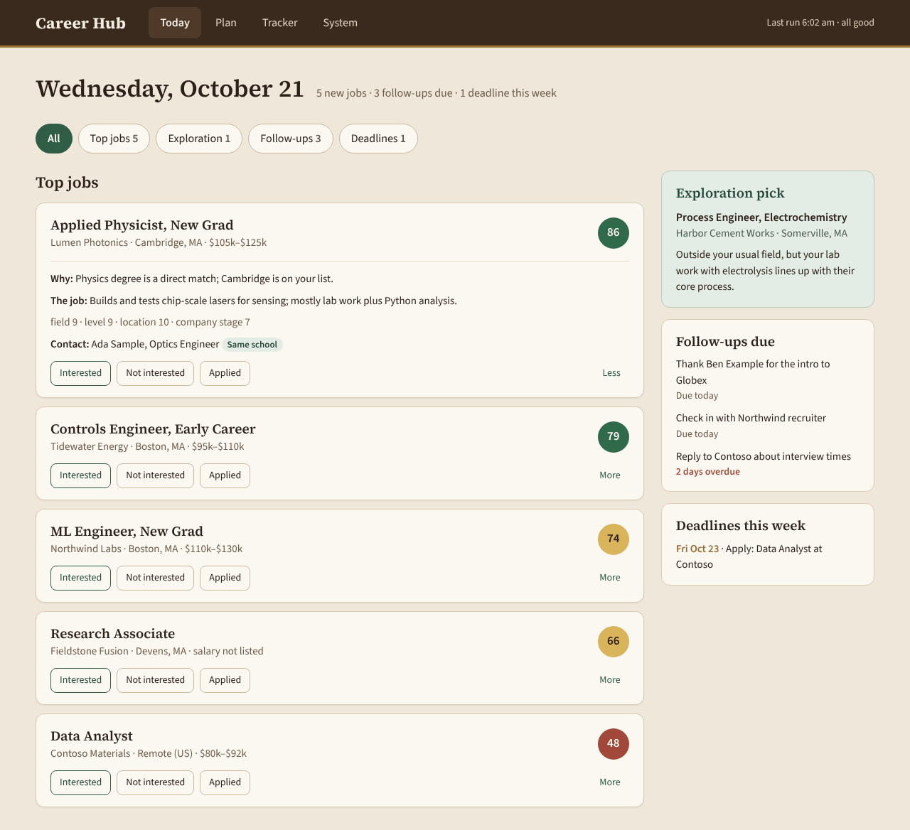
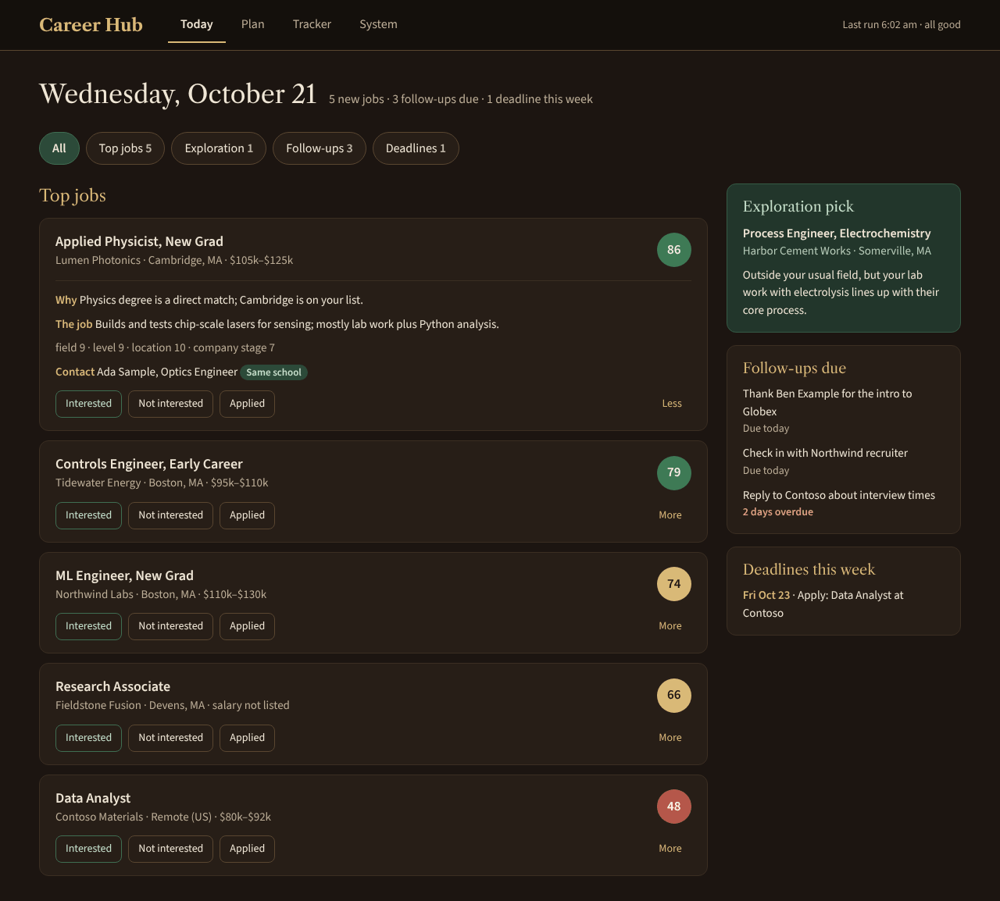
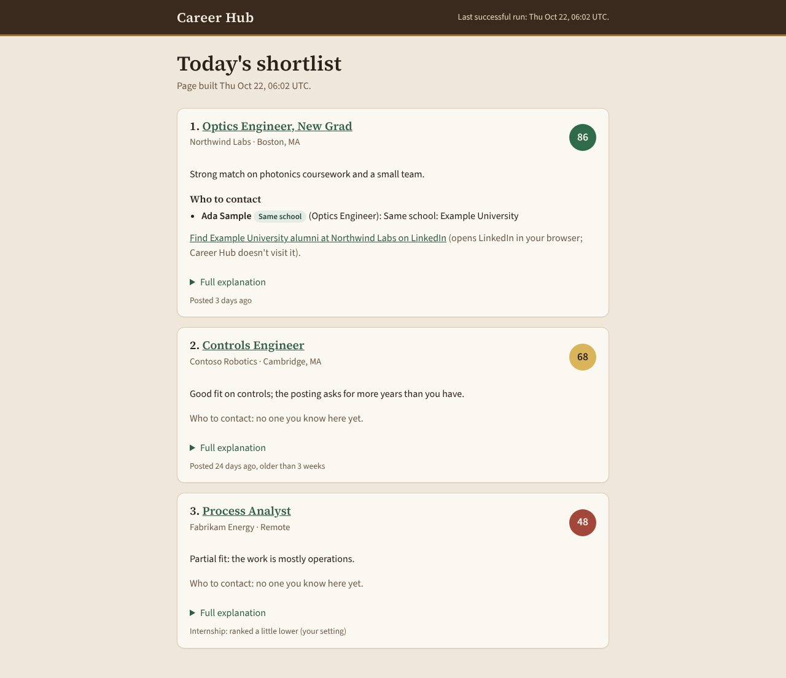
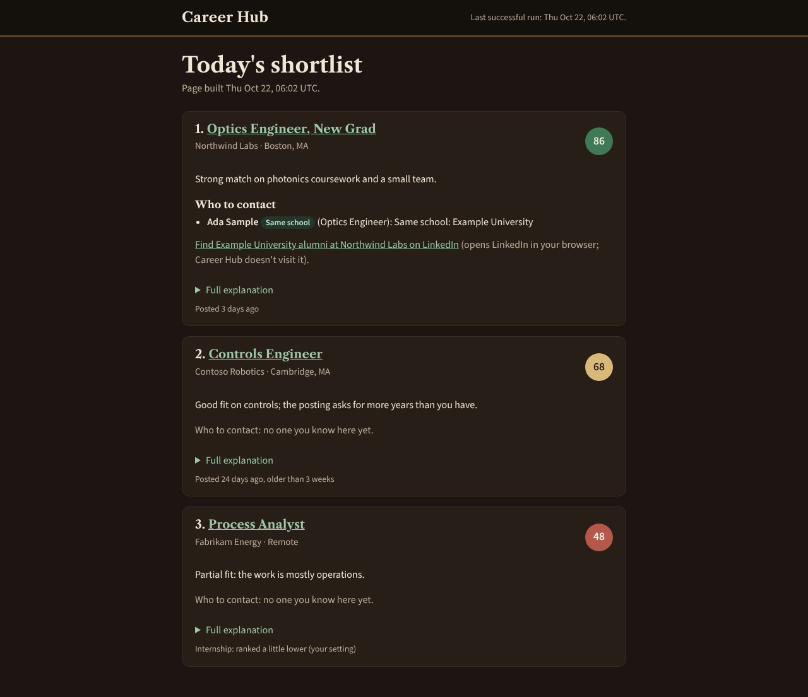

# Visual design direction

Decided by Nicholas on Oct 21 from the mockups: direction **A, "The Study"**, for light mode and
**B, "The Library at night"**, for dark mode, switched by the Mac's setting
(`prefers-color-scheme`). Colors and fonts are approved; layout will be iterated, so layout stays
separate from the tokens. (The mockup canvas is private to Nicholas.)

| Today, light (A) | Today, dark (B) |
| --- | --- |
|  |  |
|  |  |

The top row is the approved mockup (static copies: `mockups/today-light.html`, `today-dark.html`,
fictional data). The bottom row is the real nightly shortlist page with the tokens applied.

## Tone

A wood-panelled study: comfortable for long use, stately, not sparse, no neon. Brass is the only
highlight. Dark mode is the same room at night.

## Tokens

All colors, fonts, sizes, spacing, and radii are CSS custom properties in
[`src/careerhub/web/static/tokens.css`](../../src/careerhub/web/static/tokens.css): light values under
`:root`, dark under `@media (prefers-color-scheme: dark)`. **No raw hex or font name appears outside
that file** (a test checks the shortlist page's styles). Roles:

| Role | Tokens |
| --- | --- |
| Surfaces | `--page`, `--surface`, `--border`, `--divider`, `--chip-border`, `--chip-selected(-border/-text)` |
| Text | `--text`, `--muted`, `--brass-text`, `--overdue` |
| Header and tabs | `--header`, `--header-text`, `--tab-inactive`, `--tab-active`, `--brass-rule` |
| Accent and panel | `--accent`, `--accent-hover`, `--panel`, `--panel-border`, `--panel-text` |
| Score bubbles | `--score-{high,mid,low}-{bg,text}` |
| Type | `--font-body`, `--font-heading`, `--heading-weight`, `--size-*`, `--line-*` |
| Space and shape | `--space-1..6`, `--radius-sm/md/pill`, `--shadow-card`, `--focus` |

**Type.** Body is Source Sans 3 (16 px, line height 1.5) in both modes. Headings are Source Serif 4 in
light mode and Libre Caslon Text in dark mode (the heading font is a token, as are heading sizes and
line heights; give heading boxes room so a mode switch doesn't push content around). Fonts are bundled
in `src/careerhub/web/static/fonts/` with their licenses (all SIL Open Font License); pages load them
from a relative `fonts/` folder, never from the internet.

**Score bubbles.** 44 px circle, bold number, with an `aria-label` ("Fit score 86 out of 100"). Tiers:
75 and up green, 55 to 74 brass, under 55 red; the cutoffs are the settings `score_tier_high` and
`score_tier_mid`.

**Section chips** on Today show counts (Top jobs 5, Exploration 1, Follow-ups 3, Deadlines 1; All has
no count; zero shows 0, never a hidden chip).

**Navigation.** Top tabs (Today, Plan, Tracker, System). Post-MVP: News as a tab, Jobs and Grad
Schools as a module switcher.

## Keyboard, focus, motion

Everything is reachable by keyboard; focus shows a 3 px outline in `--focus`. Motion is minimal: short
fades only (`--fade`), and none under `prefers-reduced-motion`.

## Accessibility

Targets WCAG AA in both modes. `tests/web/test_design_tokens.py` checks that every color token has a
dark value, that every text/background pair in use meets 4.5:1, and that score bubbles (large bold
text) meet 3:1.

Two values differ from the approved palette, for contrast, and are flagged for Nicholas:

- **Brass text in light mode** is `#7F5C25`, not `#9A7330`: the approved brass is only 4.07:1 on the
  card and 3.51:1 on the page, below AA for small text. The brass **rule** under the header keeps
  `#9A7330` (it is not text).
- The approved dark "high" bubble (`#F4EEE3` on `#3E7A55`) is 4.41:1; it passes as large bold text
  (3:1) and is left as approved.

Dark values the palette didn't specify were chosen to match its mood: header text `#EFE6D6`,
inactive tab `#BDAE97`, active tab `#271E17`, panel text `#C3E0CB`, divider the same as the border.
